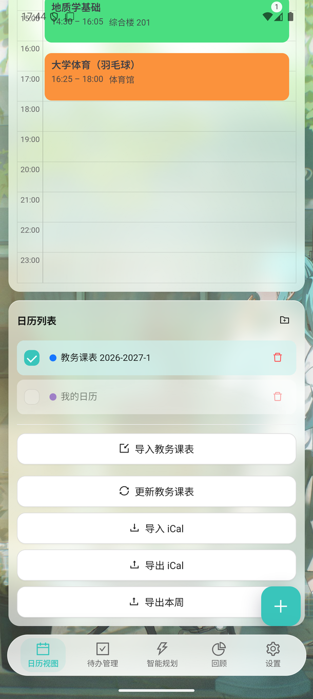
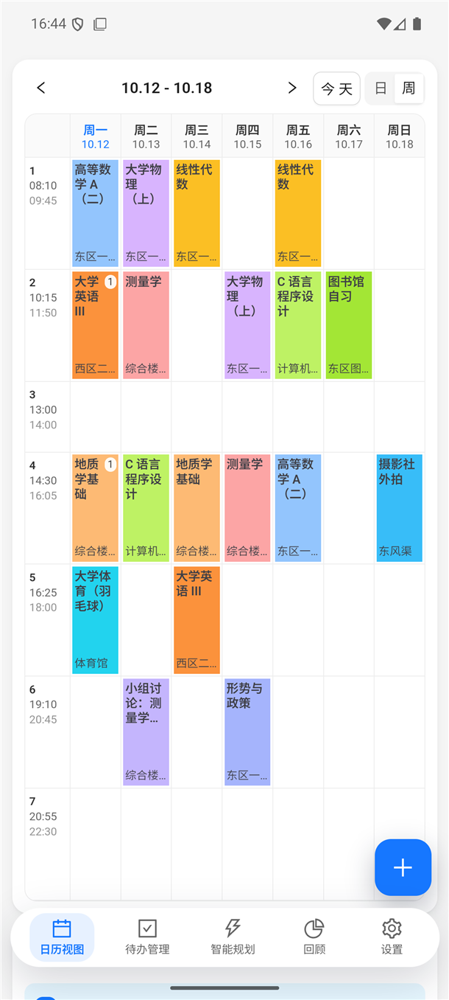
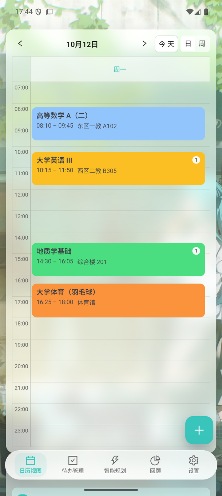
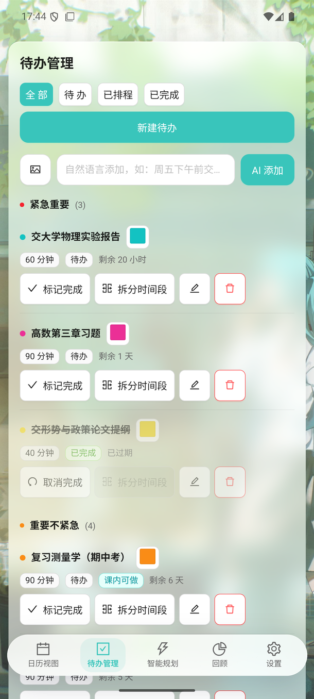
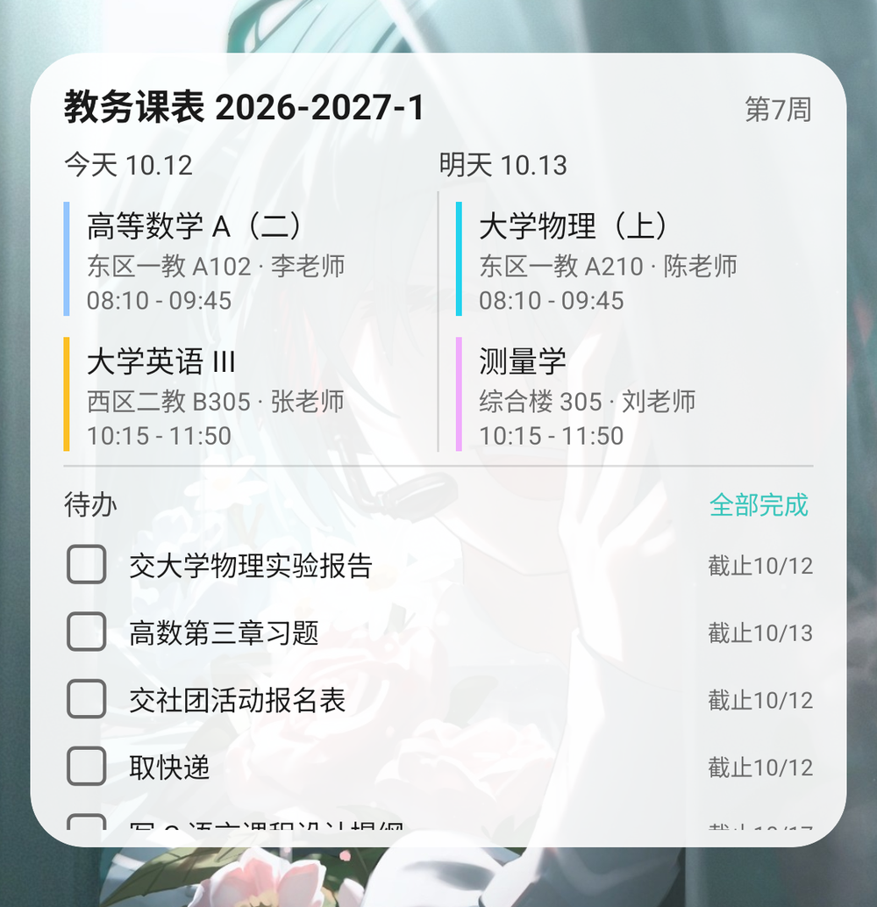
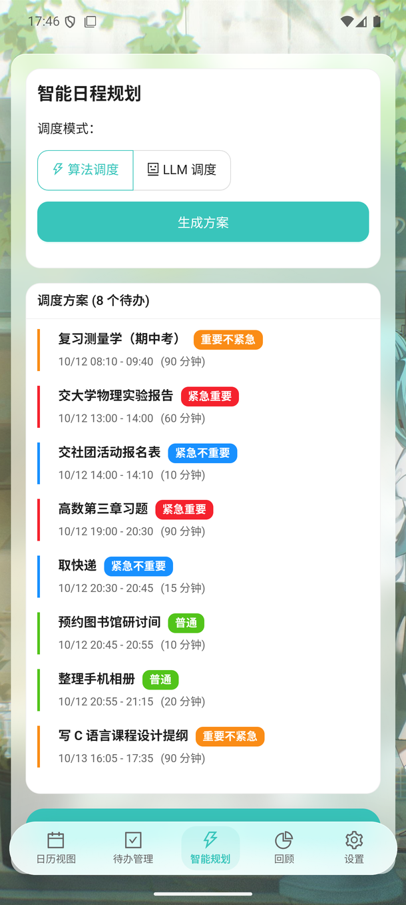
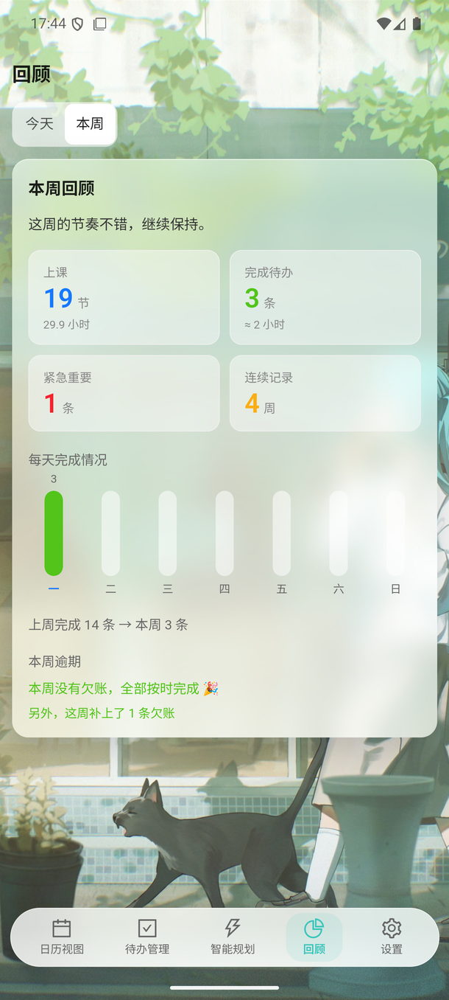
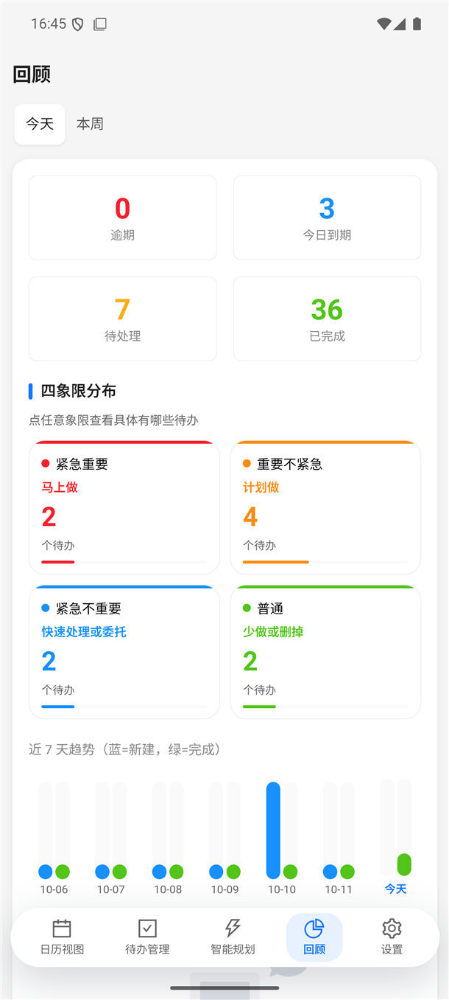
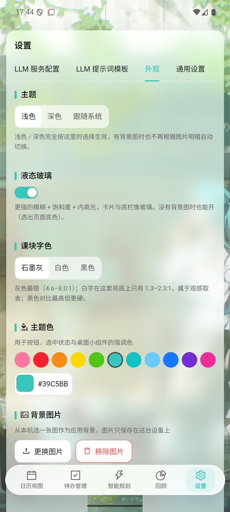
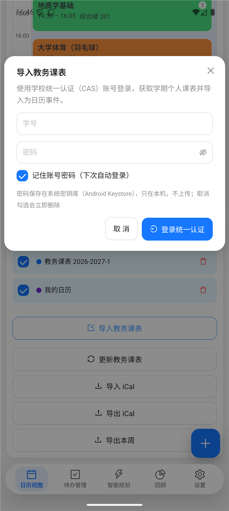

<p align="center"></p>

<h1 align="center">日日新 · ITDC</h1>

<p align="center">
  <b>Timetable + smart to-dos for Chengdu University of Technology</b><br>
  Android app / browser (PWA) · local-first · optional self-hosted sync
</p>

<p align="center">
  <a href="https://github.com/ADA-quart/ITDC/releases/latest"></a>
  <a href="https://github.com/ADA-quart/ITDC/actions/workflows/android-apk.yml"></a>
  <a href="LICENSE"></a>
  
</p>

<p align="center">
  
  
  
  
</p>

<p align="center"><sub>Screenshots taken from the Android emulator with demo data (UI is in Chinese).</sub></p>

<p align="center"><a href="README.md">简体中文</a> | <b>English</b></p>

## What is this

ITDC puts your **class timetable** and your **to-dos** in one place: sign in with the university's CAS
unified authentication to import this semester's timetable, keep it fresh automatically, get reminded
before every class, check today's plan from a home-screen widget, manage tasks with an
urgency/importance matrix — and let a **pure algorithm or an LLM** squeeze your unscheduled tasks into
the gaps of your timetable.

Highlights:

- **Local-first** — data lives on your device (IndexedDB). Working offline, with no server at all, is the normal state.
- **Direct login to the academic system** — the app talks to the university's CAS SSO and the academic
  system from the device itself, without third-party relays.
- **Optional cross-device sync** — self-host a small Node server if you want your phone and laptop to
  share the same data ([docs/DEPLOYMENT.md](docs/DEPLOYMENT.md)).
- **Unofficial project** — built by students; not affiliated with Chengdu University of Technology.

## Features

**📚 Timetable**

- Import your real timetable through the university's unified authentication (CAS). Credentials can be
  remembered locally, encrypted by the Android Keystore.
- Automatic silent sync on the first launch of each day, plus a manual “update timetable” action.
- Day / week / timetable-grid views with smooth swiping, per-course stable colors (18-color bright
  palette), custom color per course, three text-tone options.
- Class reminders before each lesson (default: 10 minutes, adjustable), with a silent mode.

**✅ To-dos**

- Urgency × importance quadrants (P1–P4) with a quadrant overview you can drill into.
- Natural-language input (“hand in the weekly report before Friday afternoon”) — parsed by an LLM if
  configured, or by built-in offline rules if not.
- Add to-dos from screenshots/photos: multimodal LLM direct reading, with an optional offline OCR
  (PP-OCRv4 on onnxruntime-web) fallback.
- “Can do in class” flag, time splitting (smart or manual), and reminders based on scheduled time or deadline.

**🧠 Smart scheduling**

- **Algorithm mode** — fully local, no model required: packs to-dos into free slots while avoiding
  classes, lunch breaks and late nights.
- **LLM mode** — works with any OpenAI-compatible service (DeepSeek, OpenAI, Ollama…).
- Every generated plan runs through a conflict validator; unschedulable items are reported explicitly.
- In-class tasks merged into a lesson show up in that lesson's details and as a badge on the timetable.

**📈 Review**

- Today: overdue / due today / pending / done, a 7-day created-vs-done trend and quadrant distribution.
- Weekly: lessons attended, to-dos completed, streak, daily completion chart, comparison with last week.

**🧩 Home-screen widget (Android)**

- Two sizes (standard 4×2 and compact 2×2) sharing the same data, adapting to resizing.
- Today + tomorrow columns and a scrollable to-do list; finished classes disappear automatically.
- Tick to-dos directly on the home screen; state is written back when the app is opened.
- Independent appearance: panel color/opacity, light/dark, background image with pre-blur.

**🎨 Personalization**

- 11 accent presets, custom background image (focus, zoom, blur, two-layer opacity), liquid-glass mode,
  light/dark/system theme, and phone / landscape / tablet layouts.

**💾 Data**

- Local-first IndexedDB storage; iCal import/export; weekly Excel export; optional self-hosted sync;
  in-app third-party license list.

## Screenshots

<p align="center">
  
  
  
</p>

<p align="center">
  
  
  
  
</p>

## Download

Grab the APK from [Releases](https://github.com/ADA-quart/ITDC/releases/latest) (`itdc-vX.Y.Z.apk`, Android 7.0+).

- The APK is signed with a **debug key** — fine for personal use and testing, not for app stores.
- Allow “unknown sources” for the first install; later versions upgrade in place and keep your data.
- If the widget stops refreshing, set the battery policy to **unrestricted** (Chinese OEM ROMs restrict
  background apps by default).
- The web build also runs in a browser (Chrome/Edge); notifications, the widget and the system keystore
  are Android-only.

## Build from source

Requirements: Node.js 22+, JDK 21, Android SDK (platform 36 / build-tools 36).

```bash
npm install
npm run dev                 # web version at http://localhost:5173

npm run android:sync        # build web assets and sync into the Android project
cd android
./gradlew assembleDebug     # -> app/build/outputs/apk/debug/app-debug.apk
```

Local debug builds use their own application id (`io.github.adaquart.itdc.debug`) so they can coexist
with the release build. Pushing a `v*` tag makes GitHub Actions build the APK and publish a release.

## Project layout

| Path | Contents |
| --- | --- |
| `src/` | React front-end (calendar, to-dos, scheduling, review, settings) and data/business logic |
| `shared/` | Code shared by client and server: timetable parser, course colors, iCal helpers |
| `server/` | Optional sync server (Express + SQLite) |
| `plugins/itdc-widget/` | Android native plugin: widget (two sizes), notification scheduling, keystore |
| `android/` | Capacitor Android project |
| `docs/` | [Architecture](docs/ARCHITECTURE.md), [API](docs/API.md), [Deployment](docs/DEPLOYMENT.md), [Widget notes](docs/WIDGET.md) |

Stack: React + TypeScript + Vite + Ant Design + FullCalendar; Capacitor 8 (Android); IndexedDB
local-first storage; optional Express + SQLite sync server; offline OCR with PP-OCRv4
(onnxruntime-web).

## FAQ

**The imported timetable is empty.**
The academic system often has not published the new semester yet (holidays, before term starts).
Try again after it does — and make sure the semester and the “Monday of week 1” date are correct.

**Where is my data uploaded?**
Nowhere by default. Everything stays in local IndexedDB. Only if you configure an LLM service are the
relevant texts sent to that service; only if you enable cross-device sync does data go to your own
server. Credentials are kept in the Android Keystore and deleted when you untick “remember me”.

**Does it work outside Chengdu University of Technology?**
The timetable import is tailored to CDUT's academic system; calendar, to-dos, scheduling and the
widget do not depend on any school.

**iOS?**
Not supported for now — the focus is Android and the web build.

## License & disclaimer

- Code is released under the [PolyForm Noncommercial License 1.0.0](LICENSE): free to use, modify and
  share, **non-commercial only**. Required Notice: Copyright 2026 ADA-Quart & TyTs.
- This is an **unofficial** student project, not affiliated with Chengdu University of Technology.
  Academic-system data belongs to the university — please follow its rules.
- Third-party licenses: [THIRD-PARTY-NOTICES.md](THIRD-PARTY-NOTICES.md).

<p align="center"><sub>苟日新，日日新，又日新。</sub></p>
